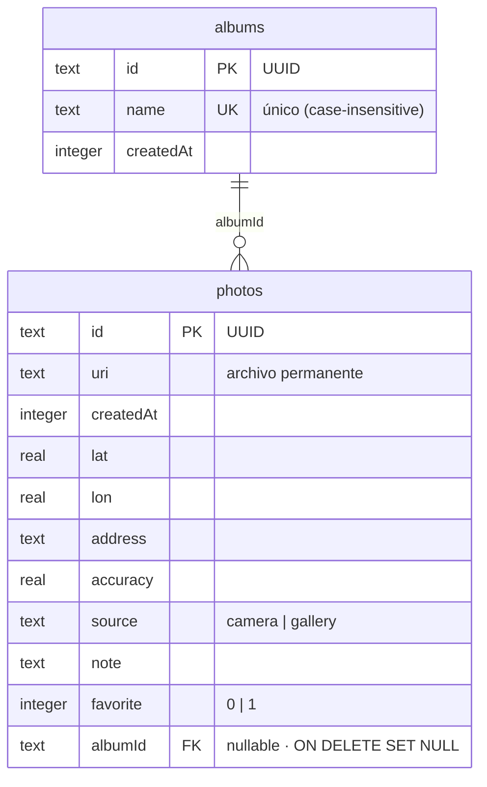

# GeoCam 📸📍

Cámara geolocalizada que etiqueta cada foto con coordenadas GPS, permite importar imágenes de la
galería, las muestra en un mapa y pregunta si se quieren borrar todas al agitar el teléfono.

> **Taller Integrador 2 — Semana 7: Persistencia local (SQLite + Drizzle) y modo offline.**
> Registro de auditoría de IA en [`AI-LOG.md`](./AI-LOG.md).

## 1. Objetivo

- Tomar fotografías con la cámara del teléfono.
- Asociar las coordenadas GPS actuales a cada fotografía.
- Importar fotografías desde la galería.
- Visualizar las fotografías geolocalizadas en un mapa.
- Detectar la sacudida del teléfono para preguntar si se desea eliminar todas las fotografías.
- Gestionar los permisos de cámara y ubicación correctamente (nunca al arrancar).
- Encapsular el acceso al hardware en **Custom Hooks tipados** (sin `any`).
- Mantener el estado de fotografías con **hooks tipados sobre SQLite** (`usePhotos`, `useAlbums`).
- **Persistir todo offline** en SQLite (`expo-sqlite`) con **Drizzle ORM**: fotos, coordenadas,
  notas, favoritos y álbumes sobreviven al cierre de la app.
- Guardar cada imagen como **archivo permanente** en el almacenamiento interno (`expo-file-system`),
  no solo como URI temporal.
- Añadir **ficha completa de foto** (nota editable, favorito, álbum, eliminar) navegable desde el mapa.
- Añadir una **Galería** con búsqueda por nota, filtros por álbum y favoritos, y **gestión de álbumes**
  (crear/renombrar/eliminar con nombre único), más una pantalla de **Inicio** como hub de navegación.
- Ser **compatible con la exportación web estática** (Sin SQLite: `IndexedDB` + stubs web).

## 2. Tecnologías

| Área | Tecnología |
| --- | --- |
| Framework | React Native + Expo (SDK 57) |
| Lenguaje | TypeScript (strict, sin `any`) |
| Navegación | Expo Router (NativeTabs en SDK 57) |
| Cámara | `expo-camera` (`CameraView`, `useCameraPermissions`) |
| Ubicación | `expo-location` |
| Galería | `expo-image-picker` |
| Sensores | `expo-sensors` (`Accelerometer`) |
| Mapa | `react-native-maps` (`MapView`, `Marker`) |
| Estado global | Hooks tipados sobre SQLite (`useLiveQuery`) en nativo / IndexedDB (web) |
| Base de datos | `expo-sqlite` + `drizzle-orm` (0.45.x) + `drizzle-kit` (0.31.x) |
| Almacenamiento | `expo-file-system` (fotos en `documentDirectory`) + IndexedDB (web) |
| Migraciones | Drizzle Kit (`drizzle/`), aplicadas con `useMigrations` |
| Estilos | NativeWind v4 (Tailwind CSS 3) sobre el tema oscuro |

## 3. Requisitos de instalación

- **Node.js** 18+ y `npm` (no hay `bun.lock`, el proyecto usa npm).
- **Expo Go** en un **teléfono físico** (Android o iOS).
- Conexión del teléfono y el equipo a la **misma red Wi-Fi** (o usar `--tunnel`).
- No se necesitan Xcode ni Android Studio para probar, salvo que se quiera un **build propio**.

## 4. Comandos

```bash
npm install            # instala dependencias (respeta package-lock.json)
npx expo start         # arranca el servidor de desarrollo
npx expo start --tunnel  # si el teléfono no ve al equipo en la LAN
npx expo lint          # ESLint
npx tsc --noEmit       # typecheck
npx expo-doctor        # diagnóstico de dependencias/config
npx expo install --check   # comprueba versiones compatibles con el SDK
npx expo export --platform web    # bundle web + regenera typedRoutes
npx expo export --platform android   # bundle android (módulos nativos)

npm run db:generate    # genera migraciones Drizzle desde src/db/schema.ts
npm run db:studio      # abre el explorador web de la base de datos
```

Instalación de paquetes nativos (nunca `npm install <pkg>` a secas):

```bash
npx expo install expo-camera expo-location expo-image-picker expo-sensors react-native-maps \
  expo-sqlite expo-file-system
```

Base de datos (versiones estables, **no** candidatos a release `@rc`):

```bash
npm install drizzle-orm@0.45.4
npm install -D drizzle-kit@0.31.11 babel-plugin-inline-import@3.0.0
```

## 5. Estructura de carpetas

```
src/
├── app/                         # rutas (Expo Router)
│   ├── _layout.tsx              # Stack raíz + DatabaseGate + splash
│   ├── (app)/                   # grupo de pestañas
│   │   ├── _layout.tsx          # NativeTabs (Inicio, GeoCam, Galería, Mapa)
│   │   ├── index.tsx            # Pestaña 1 · Inicio (hub de navegación)
│   │   ├── geocam.tsx           # Pestaña 2 · Cámara (captura + galería)
│   │   ├── galeria.tsx          # Pestaña 3 · Galería (búsqueda/filtros/álbumes)
│   │   ├── mapa.tsx             # Pestaña 4 · Mapa (react-native-maps)
│   │   └── mapa.web.tsx         # Fallback de mapa para web
│   └── foto/[id].tsx            # Ficha de foto: nota, favorito, álbum, eliminar
├── components/
│   ├── PermissionPrimer.tsx     # UI reutilizable de permisos (pedir / abrir ajustes)
│   ├── PhotoDetailModal.tsx     # Detalle emergente: foto + mapa + dirección
│   ├── PhotoDetailModal.web.tsx # Variante web (sin mapa)
│   ├── PhotoCard.tsx            # Tarjeta de foto para la Galería
│   ├── AlbumSelector.tsx        # Chips para filtrar/asignar álbum
│   ├── AlbumManagerModal.tsx    # Crear/renombrar/eliminar álbumes
│   ├── app-tabs.tsx             # Triggers de las 4 pestañas nativas
│   └── app-tabs.web.tsx         # Triggers de las pestañas en web
├── db/                          # Capa de datos (solo JS/TS, sin componentes)
│   ├── schema.ts                # Definición de tablas Drizzle
│   ├── client.ts                # Abre SQLite de forma perezosa (getDb)
│   ├── bootstrap.ts             # migrate() + seed inicial (nativo)
│   ├── bootstrap.web.ts         # Stub web (la web estática no usa SQLite)
│   ├── seed.ts                  # Álbumes de ejemplo si la tabla está vacía
│   ├── errors.ts                # Errores de dominio (p. ej. AlbumNameError)
│   ├── webStore.ts              # Persistencia web con IndexedDB (KV + blobs)
│   ├── mappers.ts               # Fila↔entidad (rowToPhoto, rowToAlbum, …)
│   └── repositories/
│       ├── photos.ts            # Insert/queries live + filtros + withLocation
│       └── albums.ts            # CRUD de álbumes + nombre único + limpieza album_id
├── services/
│   ├── photoFiles.ts            # Copia/borra imágenes y limpia huérfanos
│   └── photoFiles.web.ts        # Stub web (no-op)
├── hooks/
│   ├── useGeoLocation.ts        # Permisos + getCurrent + watchPositionAsync
│   ├── useCamera.ts             # CameraView, permisos, captura, cambio de cámara
│   ├── useShake.ts              # Acelerómetro con umbral y cooldown
│   ├── usePhotos.ts / .web.ts   # PhotosFilter reactivo (búsqueda, álbum, favoritas)
│   └── useAlbums.ts / .web.ts   # CRUD de álbumes con validación de nombre
├── types/
│   ├── geo.ts                   # GeoPhoto, Album, NewPhotoInput, PhotosFilter…
│   └── (tipos de la DB en drizzle-orm)
└── utils/
    └── id.ts                    # crea ids (crypto.randomUUID)
drizzle/                         # migraciones generadas (no editar a mano)
├── 0000_dapper_wrecking_crew.sql
├── 0001_last_bedlam.sql
├── 0002_tiresome_molten_man.sql
├── migrations.js                # manifiesto importado por useMigrations
└── meta/
```

> **Nota sobre la estructura:** las pestañas nativas (`NativeTabs`) viven en un grupo `(app)/` sin
> segmento URL propia, y el resto de la navegación (fichas) es un `Stack` en el layout raíz.
> El código no-route queda fuera de `src/app/` (ver `AGENTS.md`). La app tiene **cuatro pestañas:
> Inicio, GeoCam, Galería y Mapa**; la ficha de foto `/foto/[id]` se abre encima de ellas.

## 6. Custom Hooks

| Hook | Responsabilidad |
| --- | --- |
| `useGeoLocation({ watch? })` | Consulta el permiso al montar (sin pedirlo), `requestPermission()` por acción del usuario, `getCurrent()` puntual y `watchPositionAsync()` con bandera `cancelled` y `.remove()`. |
| `useCamera(ref)` | `useCameraPermissions()`, `onCameraReady`, `toggleFacing`, `takePhoto()` con guarda anti doble captura y `openSettings()`. |
| `useShake(onShake, { threshold?, cooldownMs? })` | `isAvailableAsync()`, `setUpdateInterval(100)`, magnitud `√(x²+y²+z²)`, umbral y cooldown, `.remove()` al desmontar. |
| `usePhotos(filter?)` | `useLiveQuery` sobre la tabla `photos` con `PhotosFilter` (búsqueda por nota, álbum `all`/`none`/id, solo favoritas) y mutaciones: `addPhoto`, `removePhoto`, `clearAll`, `updateNote`, `toggleFavorite`, `setAlbum`. Se re-renderiza ante cada cambio. |
| `useAlbums()` | `useLiveQuery` sobre `albums` y `createAlbum`, `renameAlbum`, `deleteAlbum` (antes deja `album_id = null`). Nombres vacíos o duplicados lanzan `AlbumNameError` (la DB lo respalda con índice único). |
| `usePhotos.web()` / `useAlbums.web()` | Misma API sobre el `webStore` de IndexedDB con `useSyncExternalStore` (snapshots vacíos para el render estático). |

## 7. Persistencia offline (SQLite + Drizzle)

La base de datos se abre solo al arrancar en **nativo** (`DatabaseGate` en `_layout.tsx`): se ejecutan
las **migraciones** de `drizzle/` con `useMigrations` y, si la tabla de álbumes está vacía, un **seed**
crea `Paseos`, `Playa` y `Ciudad`. Mientras se migra se mantiene la splash screen.

| Tabla | Columnas clave |
| --- | --- |
| `photos` | `id`, `uri` (archivo permanente), `createdAt`, `lat`/`lon`, `address`, `accuracy`, `source` (`camera`/`gallery`), `note`, `favorite` (0/1), `albumId` (FK → `albums.id`, `ON DELETE SET NULL`) |
| `albums` | `id`, `name` (índice único), `createdAt`, `photoCount` (columna computada en la query) |



Reglas:

- **`PRAGMA foreign_keys = ON`** en cada conexión; `enableChangeListener` para `useLiveQuery`.
- **Nombre de álbum único**: la migración `0002` crea `CREATE UNIQUE INDEX albums_name_unique`;
  además los repos validan con una query `LOWER(name)` (parámetro SQL, sin concatenar texto).
- Al **eliminar un álbum**, el repositorio primero pone `album_id = NULL` en sus fotos (la migración
  ALTER generada por drizzle-kit no re-emite `ON DELETE`; la corrección se hace en la capa de datos).
- Al **borrar una foto** se elimina también su **archivo permanente** en `documentDirectory`.
- Después de borrar, `cleanupOrphanedPhotos()` compara los archivos con los id vivos de SQLite y
  descarta los huérfanos (`Directory.list()` de `expo-file-system`).
- `usePhotos` construye la query con filtros reactivos (`and`, `like`, `eq`, `isNull`) y
  `photosWithLocation` para el mapa (solo filas con coordenadas).
- **Web** (build estático): la app no usa SQLite; `src/db/webStore.ts` persiste en **IndexedDB**
  (almacén KV de metadatos + almacén de blobs, con URLs de objeto revocadas) y los hooks `.web`
  reaccionan con `useSyncExternalStore`. `bootstrap.web.ts` y `photoFiles.web.ts` son stubs para no
  arrastrar `expo-sqlite`/WASM al bundle web.

## 8. Funcionamiento de los permisos (tres estados)

La app **nunca** solicita permisos al abrirse. Primero **consulta** (`getForegroundPermissionsAsync`),
luego muestra el `PermissionPrimer` explicando el motivo, y solo pide cuando se toca **Permitir
acceso**. La ubicación se pide en contexto (banner en GeoCam), no en un bloqueo inicial.

| Estado | Comportamiento | Captura |
| --- | --- | --- |
| **Concedido** | Cámara + coordenadas en vivo; la foto queda etiquetada con `coords`. | `docs/permisos/concedido.png` |
| **Rechazado** | Reaparece el `PermissionPrimer` para volver a pedir; la cámara sigue funcionando y las fotos quedan con `coords: null`. | `docs/permisos/rechazado.png` |
| **Bloqueado** | `canAskAgain === false` → el botón cambia a **Abrir Ajustes** (`Linking.openSettings()`). | `docs/permisos/bloqueado.png` |

> Las imágenes de `docs/permisos/*.png` son **marcadores de posición**: reemplázalas por capturas o
> GIF reales de tu teléfono antes de entregar. No se han adjuntado capturas todavía.

## 9. Cómo probar cada comportamiento (teléfono físico)

Las pruebas 1–11 y 13–23 se hacen en **Expo Go** con un teléfono real. Las pruebas 12 y 23 se hacen en
el equipo. Los textos personalizados de permisos (prueba 5) requieren un **development/production
build**, porque Expo Go muestra textos genéricos del sistema.

| # | Comportamiento | Cómo probarlo | ¿Expo Go? |
| --- | --- | --- | --- |
| 1 | No se piden todos los permisos al abrir | Abre la app y observa que no aparece ningún diálogo hasta tocar una acción. | Sí |
| 2 | Rechazar ubicación no rompe la cámara | En GeoCam, rechaza el banner de ubicación y toma una foto. | Sí |
| 3 | Fotos sin ubicación se guardan | Con la ubicación rechazada, la foto aparece en el mapa en "Sin ubicación". | Sí |
| 4 | Fotos con coordenadas | Concede ubicación, toma una foto y verifica lat/lon en pantalla y en el marcador. | Sí |
| 5 | Permiso bloqueado → "Abrir Ajustes" | Rechaza dos veces (Android) y confirma que el botón cambia a Abrir Ajustes. | Build propio (textos) |
| 6 | Galería vs cámara | Importa una imagen y observa la etiqueta "Galería" vs "Cámara". | Sí |
| 7 | Marcadores solo con coordenadas | Observa que no hay marcadores en (0,0) ni nulos. | Sí |
| 8 | Sección "Sin ubicación" | Confirma que las fotos sin coords aparecen listadas aparte. | Sí |
| 9 | Sacudida → confirmación | Agita el teléfono: aparece el `Alert` con Cancelar / Borrar; solo borra al confirmar. | Sí |
| 10 | Limpieza de suscripciones | Cambia de pestaña / cierra la app y verifica que no queden errores de GPS o sensor en el log. | Sí |
| 11 | Errores visibles en la UI | Activa el GPS del sistema y observa el estado del hook; con GPS apagado no se bloquea la cámara. | Sí |
| 12 | Sin errores de TypeScript | `npx tsc --noEmit` y `npx eslint .` sin salida. | Equipo |
| 13 | Persistencia tras reiniciar | Toma 2–3 fotos, cierra la app por completo y relánzala en Expo Go: las fotos siguen en el mapa y en la ficha. | Sí |
| 14 | Notas y favoritos guardados | En la ficha de foto escribe una nota y toca el corazón; reinicia y comprueba que ambas cosas se conservan. | Sí |
| 15 | Álbumes | Crea un álbum desde la ficha, asigna fotos; reinicia y verifica que la agrupación persiste. Al borrar un álbum sus fotos no se pierden (quedan sin álbum). | Sí |
| 16 | Mudanza de BLOB a archivo | Verifica en el explorador de archivos que no hay fotos BLOB en la base: las imágenes viven en `documentDirectory/fotos/*`. | Sí (build propio) |
| 17 | Migración desde cero | Desinstala Expo Go o borra datos de la app; al arrancar se ejecutan las 3 migraciones (0000–0002) y el seed (sin SQLite previo). | Sí |
| 18 | Galería con búsqueda | Abre la pestaña **Galería**, escribe en el buscador (coincide con el texto de `note`); la rejilla filtra en vivo. | Sí |
| 19 | Filtros combinados | En **Galería** toca un álbum, "Sin álbum" y la estrella de favoritas; el resultado combina búsqueda + álbum + favorito. Al tocar "Limpiar filtros" vuelve todo. | Sí |
| 20 | Gestión de álbumes | Desde **Galería** (botón "Álbumes") crea, renombra y borra álbumes; un nombre vacío o duplicado muestra aviso sin crear. Borrar un álbum deja sus fotos sin álbum. | Sí |
| 21 | Galería importada | Importa una imagen desde **GeoCam**: aparece en **Galería** como `Galería`, con su archivo permanente y sin coordenadas si no había GPS. | Sí |
| 22 | Offline completo tras reiniciar | Cierra la app por completo y relánzala: fotos, notas, favoritos, álbumes y archivos permanentes se conservan (verificación final de la Semana 7). | Sí |
| 23 | Web con IndexedDB | `npx expo export --platform web` y sirve `dist` en el navegador: importa una foto, recarga la página y debe seguir visible (persistencia en IndexedDB). | Equipo |

### Inicio
La pestaña **Inicio** es el hub de la app: tres tarjetas navegan a **Cámara**, **Galería** y **Mapa**.
Es la ruta inicial (`initialRouteName: 'index'`) y en web la marca "📍 GeoCam" abre la misma pantalla.

### Cámara
Abre **GeoCam**, toca **Permitir acceso**, apunta y usa el botón circular. La miniatura de la última
foto (con 📍) abre el detalle. `↻` cambia entre cámara frontal y trasera.

### Ubicación
Con la ubicación concedida verás lat/lon y `±N m` arriba a la derecha. Sin permiso aparece el banner
ámbar "Activa la ubicación…". La cámara funciona en ambos casos.

### Galería
Toca **🖼️** → `ImagePicker.launchImageLibraryAsync({ mediaTypes: ['images'], quality: 0.7 })`. La
imagen se guarda con `source: 'gallery'` y coordenadas actuales (o `null`).

### Galería (rejilla, búsqueda y álbumes)
La pestaña **Galería** muestra todas las fotos en una rejilla responsiva (2–5 columnas según el ancho).
El buscador filtra por el texto de `note`, y las chips de álbum (incluidos **Sin álbum** y **Solo
favoritas**) se combinan entre sí. El botón **Álbumes** abre el `AlbumManagerModal` para crear,
renombrar (toca el lápiz) o eliminar (toca la papelera y confirma). Una tarjeta con **sin GPS** avisa de
que la foto no tiene coordenadas; la estrella marca/desmarca favoritas y abre la ficha `/foto/[id]`.

### Mapa
Toca un marcador → mini-panel; toca "Ver lugar →" para abrir el detalle con foto, mapa del punto y
**dirección** (geocodificación inversa con `Location.reverseGeocodeAsync`). Las fotos sin coords
aparecen en "Sin ubicación".

### Acelerómetro
Agita el teléfono → `Alert.alert` con "Cancelar" y "Borrar" (`destructive`). Solo borra si confirmas.
El seguimiento se limpia al salir de la pantalla.

### Persistencia y ficha de foto
Cada foto se guarda en SQLite y su imagen se copia a `documentDirectory/fotos/`. En la ficha
(`/foto/[id]`, botón "Abrir ficha completa" o tocar una foto en GeoCam) puedes **editar la nota**,
**marcar como favorita** (corazón), **asignar/crear álbumes** y **eliminar** la foto (borra también el
archivo). Todo se actualiza en vivo en mapa y lista gracias a `useLiveQuery`.

## 10. Limitaciones de Expo Go

- **La cámara no funciona en el simulador de iOS**: usa un teléfono físico.
- Los **textos personalizados de permisos** definidos en `app.json` (plugins) requieren un
  **development/production build**; Expo Go muestra textos genéricos.
- `react-native-maps` funciona en Expo Go, pero un build de Android para producción necesita una
  **clave de Google Maps** (el plugin de Maps no se añadió a propósito).
- El acelerómetro y el GPS requieren hardware real; el comportamiento en simulador es limitado.
- El selector de imágenes del sistema no exige un permiso explícito de galería en las versiones
  recientes de Android/iOS (no se solicita uno innecesario).

## 11. Capturas de pantalla

Pendientes de adjuntar. Reemplaza estos marcadores por capturas/GIF reales de tu teléfono (y uno del
navegador para la web) antes de entregar:

- `docs/permisos/concedido.png`
- `docs/permisos/rechazado.png`
- `docs/permisos/bloqueado.png`
- `docs/inicio.png`
- `docs/galeria.png` *(rejilla con búsqueda y filtros)*
- `docs/web.gif` *(demo web con IndexedDB)*

## 12. Verificación

```bash
npx tsc --noEmit                     # typecheck
npx expo lint                        # ESLint
npx expo install --check             # versiones compatibles con el SDK
npx expo-doctor                      # 21 checks de dependencias/config
npx expo export --platform web       # bundle + rutas estáticas + typedRoutes
npx expo export --platform android   # bundle android (módulos nativos)
```

## Learn more

- [Expo documentation](https://docs.expo.dev/)
- [Expo Camera](https://docs.expo.dev/versions/latest/sdk/camera/)
- [Expo Location](https://docs.expo.dev/versions/latest/sdk/location/)
- [Expo ImagePicker](https://docs.expo.dev/versions/latest/sdk/imagepicker/)
- [Expo Sensors](https://docs.expo.dev/versions/latest/sdk/accelerometer/)
- [React Native Maps](https://github.com/react-native-maps/react-native-maps)
- [Expo SQLite](https://docs.expo.dev/versions/latest/sdk/sqlite/)
- [Expo FileSystem](https://docs.expo.dev/versions/latest/sdk/filesystem/)
- [Drizzle ORM – Expo SQLite](https://orm.drizzle.team/docs/get-started/expo-sqlite)
- [Drizzle Kit migrations](https://orm.drizzle.team/docs/kit-overview)
